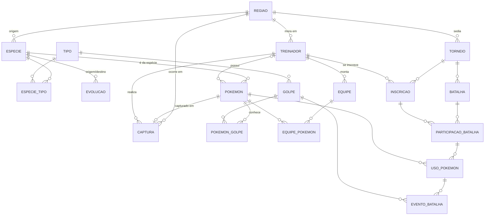

# Liga Pokémon — Consultas SQL

20 consultas em **PostgreSQL** sobre um banco de dados de treinadores, capturas, golpes e torneios Pokémon, das mais simples (JOIN + filtro) até divisão relacional e `ROLLUP`.


---

## Sobre o projeto

Este repositório reúne o modelo relacional **Liga Pokémon** (esquema + carga de dados fictícios) e as **20 consultas** que desenvolvi sobre ele para praticar SQL: junções, agregações, subconsultas, operadores de conjunto e agrupamentos avançados.

Cada consulta no arquivo tem um comentário curto explicando o que ela responde.

## Estrutura

```
sql/
├── 01_criacao_liga_pokemon.sql   # esquema: 19 tabelas, chaves e restrições
├── 02_carga_liga_pokemon.sql     # carga de dados fictícios e reproduzíveis
└── 03_consultas.sql              # as 20 consultas
```

## O modelo de dados

O schema `liga_pokemon` tem 19 tabelas organizadas em 5 blocos:

| Bloco | Tabelas |
|---|---|
| Mundo Pokémon | `regiao`, `especie`, `tipo`, `especie_tipo`, `evolucao` |
| Treinadores e capturas | `treinador`, `pokemon`, `captura` |
| Golpes | `golpe`, `especie_golpe`, `pokemon_golpe` |
| Equipes | `equipe`, `equipe_pokemon` |
| Torneios e batalhas | `torneio`, `inscricao`, `batalha`, `participacao_batalha`, `uso_pokemon`, `evento_batalha` |



**Volume da carga:** 8 regiões · 250 espécies · 18 tipos · 120 treinadores · 1.500 Pokémons · 120 golpes · 200 equipes · 35 torneios · 700 inscrições · 1.000 batalhas · 2.000 participações · 6.000 usos de Pokémon · 30.000 eventos de batalha.

## Como rodar

Requisito: PostgreSQL 14 ou superior.

```bash
createdb liga
psql -d liga -f sql/01_criacao_liga_pokemon.sql
psql -d liga -f sql/02_carga_liga_pokemon.sql
psql -d liga -f sql/03_consultas.sql
```

Também dá para abrir os arquivos no pgAdmin ou DBeaver e executar na mesma ordem.

> ⚠️ O script `01` apaga e recria o schema `liga_pokemon`. O `02` deve ser executado uma única vez sobre o schema vazio.

## As consultas

| # | O que responde | Conceitos |
|---|---|---|
| 1 | Pokémons de nível ≥ 50 que têm treinador | `JOIN`, `WHERE`, `ORDER BY` |
| 2 | Combinações de região do treinador × tipo do Pokémon | `DISTINCT`, múltiplos `JOIN` |
| 3 | Total de Pokémons por treinador e quantos têm nível ≥ 40 | `LEFT JOIN`, `COUNT ... FILTER` |
| 4 | Capturas realizadas em 2025 | `JOIN`, filtro por intervalo de datas |
| 5 | Treinadores com ≥ 5 espécies distintas e nível médio > 30 | `COUNT DISTINCT`, `AVG`, `HAVING` |
| 6 | Torneios com ≥ 10 batalhas concluídas e % de empates | `FILTER`, `ROUND`, `HAVING` |
| 7 | Pokémons acima da média da própria espécie | Subconsulta correlacionada |
| 8 | Golpe mais forte de cada categoria | Subconsulta correlacionada com `MAX` |
| 9 | Evoluções: origem, destino, nível mínimo e item | Auto-relacionamento (2× `especie`) |
| 10 | Golpe mais forte de cada categoria (outra forma) | `> ALL` |
| 11 | Treinadores com ≥ 10 batalhas e mais de 70% de vitórias | `FILTER`, `HAVING` com expressão |
| 12 | Espécies com Pokémon cadastrado que nunca foi usado em batalha | `EXISTS` / `NOT EXISTS` |
| 13 | Pokémons acima da média global de nível | Subconsulta escalar |
| 14 | Treinadores que já capturaram em Kanto | `IN` com subconsulta |
| 15 | Treinadores que têm Pokémons de **todos** os tipos de Kanto | Divisão relacional (`NOT EXISTS` duplo) |
| 16 | Evoluções do Charmander em 1 e 2 etapas | `UNION`, auto-junção de `evolucao` |
| 17 | Dono(s) do Pokémon de maior nível | Subconsulta com `MAX` |
| 18 | Regiões com ≥ 20 capturas e data da última | Subconsulta no `FROM` |
| 19 | Pokémons por região e raridade, com subtotais | `ROLLUP`, `GROUPING` |
| 20 | Treinadores com mais Pokémons que a média | Subconsulta aninhada no `HAVING` |

## Destaques

### Divisão relacional (consulta 15)

"Quais treinadores têm Pokémons de **todos** os tipos que aparecem em Kanto?" SQL não tem um operador "para todo", então a pergunta é reescrita como *não existe tipo de Kanto que o treinador não tenha*:

```sql
SELECT t.id_treinador, t.nome
FROM   treinador t
WHERE  NOT EXISTS (
        SELECT 1
        FROM   tipo tp
        WHERE  tp.id_tipo IN (SELECT et.id_tipo
                                FROM especie e
                                JOIN regiao r ON r.id_regiao = e.id_regiao
                                JOIN especie_tipo et ON et.id_especie = e.id_especie
                               WHERE r.nome = 'Kanto')
          AND  NOT EXISTS (
                SELECT 1
                FROM   pokemon p
                JOIN   especie_tipo et2 ON et2.id_especie = p.id_especie
                WHERE  p.id_treinador = t.id_treinador
                  AND  et2.id_tipo    = tp.id_tipo
          )
);
```

### Subtotais com ROLLUP (consulta 19)

Uma única consulta devolve a contagem por região e raridade, o subtotal de cada região e o total geral. `GROUPING()` indica quais linhas são de resumo:

```sql
SELECT   r.nome AS regiao,
         e.raridade,
         GROUPING(r.nome)     AS resumo_regiao,
         GROUPING(e.raridade) AS resumo_raridade,
         COUNT(p.id_pokemon)  AS quantidade
FROM     pokemon p
JOIN     treinador t ON t.id_treinador = p.id_treinador
JOIN     regiao r    ON r.id_regiao    = t.id_regiao
JOIN     especie e   ON e.id_especie   = p.id_especie
GROUP BY ROLLUP (r.nome, e.raridade)
ORDER BY r.nome, e.raridade;
```

## Conceitos praticados

- `INNER JOIN`, `LEFT JOIN` e auto-junção
- Agregação: `COUNT`, `COUNT DISTINCT`, `AVG`, `MAX`, `FILTER`
- `GROUP BY` + `HAVING`
- Subconsultas escalares, correlacionadas, no `FROM` e no `HAVING`
- `IN`, `EXISTS`, `NOT EXISTS`, `> ALL`
- Divisão relacional
- `UNION`
- `ROLLUP` e `GROUPING`

## Autora

**Paula Moschioni** · [GitHub](https://github.com/paulamoschioni)
